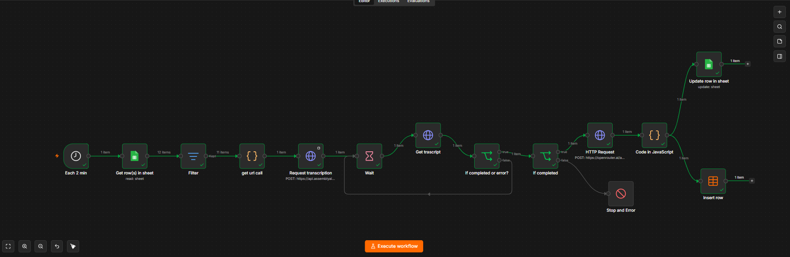

# AI Call Analysis for a Confectionery

**n8n · AssemblyAI · OpenAI / OpenRouter · Google Sheets · n8n Data Tables**

Customer call recordings become searchable transcripts, categorized feedback and structured call statistics.

## Problem

Employees had to listen to calls, interpret customer feedback and manually record the findings. This repetitive work made it harder to maintain a consistent picture of product and service issues.

## Solution

Call recording → AssemblyAI transcription → AI dialogue and sentiment analysis → call categorization → Google Sheets and n8n Data Tables → statistics assistant.

- Transcribe conversations automatically.
- Identify customer sentiment and classify call topics.
- Store structured results for review.
- Present call-category statistics through an AI assistant.

## Workflow

## Results

- **Automatic call processing:** recordings are transcribed, categorized and analyzed for customer sentiment.
- **Structured analytics:** call results and feedback categories are stored in a consistent process.
- **Less repetitive listening:** staff can review structured findings and spend more time on customer service.
- **Estimated time savings:** for approximately **325 calls per month**, the Notion case models a **70–85% reduction in manual processing**, equivalent to around **11–14 staff hours per month**. These figures are estimates from the case scenario, not independently measured production results.

## Tech Stack

n8n, AssemblyAI API, OpenAI / OpenRouter API, Google Sheets, n8n Data Tables, prompt design.

## Demo & Case Study

- [Call analysis demo](https://youtu.be/b2ceZTnuW0M)
- [Statistics assistant demo](https://youtu.be/Fkuazud_V2g)
- [Read the full Notion case](https://tangy-whitefish-6d0.notion.site/7abc12839d0683c5ae2a01aba7aefbd3)

## Author

**Pavlo Holnyk — AI Automation & AI Agents**

[Portfolio](https://tangy-whitefish-6d0.notion.site/408c12839d06816f9e61ff1aa7392587) · [LinkedIn](https://www.linkedin.com/in/pavlo-holnyk/) · [Upwork](https://www.upwork.com/freelancers/~011ee82fd5725aa92e)

